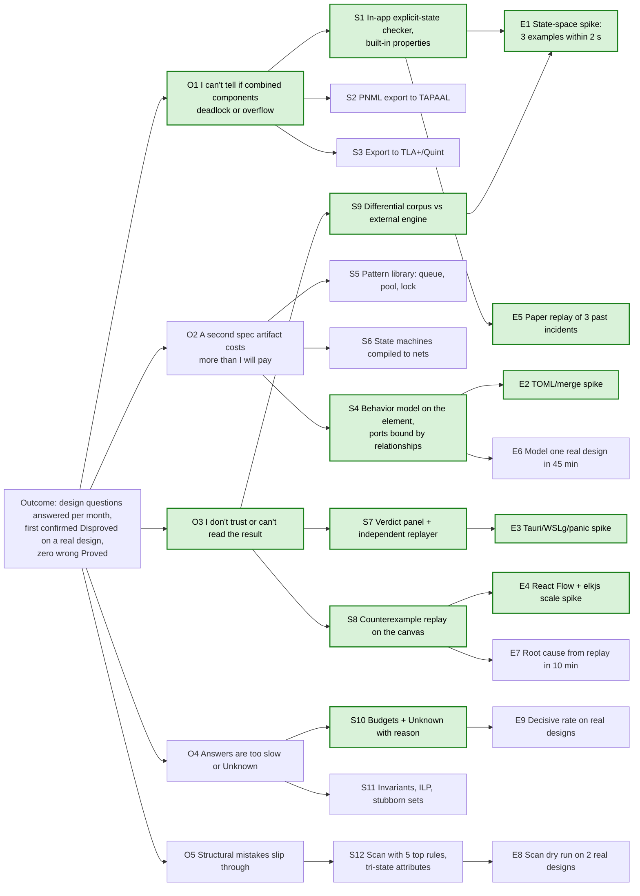

# Opportunity solution tree

As of 2026-11-02, after Teresa Torres. Outcome from `north-star.md`, opportunities from `problems.md` (user needs, not features). **Bold green / [skeleton]** = the v1 walking skeleton branch (`v1-slices.md`). Experiments are cheap first: paper and spikes, then dogfooding.

## Nested tree

- **Outcome:** design questions answered per month on real designs; v1 gate = first confirmed Disproved that changes a decision; guardrail zero wrong Proved.
  - **O1 "I can't tell whether components that look fine alone deadlock or overflow together."** [skeleton]
    - S1 In-app explicit-state checker for bounded nets with deadlock-free and no capacity exceeded. **[skeleton]**
    - S2 Export PNML and check in TAPAAL. Cheap, but the user leaves the architecture; kept as a dev-only cross-check.
    - S3 Export to TLA+ or Quint. Only for data-rich questions; later.
  - **O2 "Writing and syncing a separate spec costs more than I will pay."**
    - S4 One behavior model per element with ports, bound by sibling relationships (ADR 0002). **[skeleton]**
    - S5 Pattern library of reusable subnets (bounded queue, worker pool, mutex, request with timeout). Later; earlier if E6 fails.
    - S6 Flat state machines compiled to nets. Slice 2.
  - **O3 "I don't trust the result, or I can't read it."** [skeleton]
    - S7 Verdict panel with exactly one verdict, its scope and its reason; independent replayer. **[skeleton]**
    - S8 Counterexample replay on the canvas plus a text step list. **[skeleton]**
    - S9 Differential corpus checked against an external engine in CI. **[skeleton]**
  - **O4 "Answers come too slowly or end Unknown."**
    - S10 Budgets; Unknown says why and what to try. **[skeleton]**
    - S11 Structural certificates (P-invariants), ILP state equation, stubborn sets. Later; earlier if E9 fails.
  - **O5 "Structural mistakes slip through where no behavior is modeled."**
    - S12 Scan with five rules, attributes yes/no/unknown, unknown gives not checkable. Slice 5.

## Assumption tests

Run in this order. Each has a decision rule set before it runs.

| ID | Assumption (risk) | Test | Time box | Success threshold | If not met |
|---|---|---|---|---|---|
| **E5** | A1: the user's real defects fit P/T nets with capacities and bag queues, no time or order (**value, riskiest**) | Take 3 past incidents or designs; hand-model them as nets (paper or TAPAAL); check whether the defect appears | 2 days, before product code | ≥ 2 of 3 reproduced | Re-scope: colored nets or TLA+ export move earlier; reconsider the bet |
| **E1** | A4, A5: an in-house checker is correct and fast enough (**feasibility**) | State-space spike in `crates/verify`: (a) producer faster than consumer over a bag queue with capacity 3, overflow expected; (b) two components taking two locks in opposite order, deadlock expected; (c) worker pool that releases on every path, deadlock-free expected. Export each as PNML and compare with TAPAAL verifypn | 1 week | All 3 verdicts correct, each within 2 s; 100 % agreement on the corpus | Narrow v1 net class or add S11 earlier; never relax the Proved rule |
| **E2** | A7: TOML directory diffs and merges cleanly (**feasibility**) | Mock project (elements, Petri net, ports, layout); two branches editing different elements and one layout; three-way git merge | 2 days | No conflict for disjoint edits; layout change touches only layout files | Change file split before format v1 freezes (ADR 0001 migration rule) |
| **E3** | Crash policy and dev setup work (**feasibility**) | Tauri spike: panic in a check worker thread; run on WSLg and Windows WebView2 | 2 days | Check ends Unknown "internal error", app stays up, logged locally; window usable on both | Revisit ADR 0006 with the architect |
| **E4** | Canvas holds the performance targets (**feasibility, usability**) | React Flow + elkjs spike: 300 elements in one view, 2,000 in the project, on WebKitGTK | 3 days | Layout of 300 elements < 2 s in a worker; pan and zoom without visible stutter | JointJS runner-up (`docs/research/stack.md`) |
| E6 | A2: modeling with ports is fast enough (**usability**) | Model one real design in the skeleton, timed | 1 session | I1 ≤ 45 min for about 10 elements | Pattern library (S5) moves before slice 2 (rule applied at slice 1, slice 0 is the baseline) |
| E7 | A3: replay explains the root cause (**usability**) | 3 Disproved verdicts on real designs; name the root cause from the replay alone | per verdict | ≥ 2 of 3 within 10 min | Add per-step explanation of the final marking (`verification.md` §6) |
| E8 | A6: scan findings are mostly real (**value**) | Apply the 5 rules by hand to 2 real designs before building the scan | 1 day | ≤ 20 % "not real" | Drop or reword noisy rules |
| E9 | A5 on real designs (**feasibility**) | Tally verdicts in the journal for 2 weeks after the skeleton | 2 weeks | I2 ≥ 80 % decisive | Pull S11 forward |

## Riskiest assumption

A1 (value). If the user's real deadlocks and overflows need message order, request/reply matching or timing, a bag-queue Petri net cannot show them, and the v1 gate cannot be met however well the rest works. E5 costs two days and needs no product code, so run it first.
